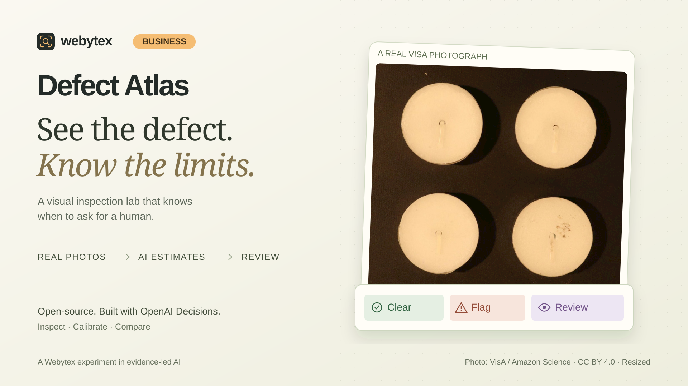

# Defect Atlas

**See the defect. Know the limits.** A visual inspection and classifier evaluation lab by [Webytex for Business](https://business.webytex.com/#quick-contact).

Explore real product photographs, compare two OpenAI Decisions policies, and choose when a person should review an image. The interesting question is not just whether AI detects an anomaly. It is what happens to missed defects, false alarms and manual workload when the automation threshold changes.

[Try the demo](https://webytex-defect-atlas.vercel.app/) · [Read the architecture](docs/ARCHITECTURE.md) · [Inspect the validation](docs/VALIDATION.md)



## Explore the lab

1. **Inspect:** choose candles or circuit boards, open a photograph, and examine the model's estimates. Saved real API outputs are labelled **Recorded run**. **Live Decisions** makes a new request after consent, for a collection photo or your own JPEG, PNG or WebP.
2. **Calibrate:** adjust the clear and flag thresholds on a separate calibration set. Images between them, unusable photographs, unsupported subjects and incomplete inspections go to human review.
3. **Compare:** freeze the thresholds before revealing holdout results for both policies. See missed defects and false alarms alongside automated coverage. Further tuning after viewing holdout results is explicitly exploratory.

Live batches process up to eight collection photographs, one at a time. Human review labels stay separate from model output and dataset truth. CSV and JSON reports retain the policy, thresholds, source, scores and review records.

This is a small public demonstration, not a production inspection or safety certification system. A clear result means no visible anomaly was detected under the selected policy. It cannot establish electrical performance, hidden defects or product safety.

## What the AI does

One OpenAI Decisions request using `gpt-6-luna` asks four questions: image usability, product family, visible anomaly probability, and visible severity on a 0–3 rubric. Application code validates the answers and applies routing rules.

**Appearance only v1** uses the target photograph and fixed inspection criteria. **Reference guided v2** adds two separate, known-normal reference photographs from the same family. These are instruction/reference policies, not retrained models. Probabilities are model estimates, not calibrated industrial guarantees.

The app uses 88 attributed VisA photographs: eight references, 32 calibration images and 48 holdout images. Each category has four references, 16 calibration images and 24 holdout images. Policy v2 sends the first two references per category. The evaluation subsets are deliberately balanced and do not estimate defect prevalence in a real operation. Source labels and annotation masks never accompany the target image in model requests.

Dataset overlays are **human-provided annotations, not AI heatmaps**. See [dataset provenance, transforms and licenses](docs/DATASET.md).

## Run locally

Use Node.js 24 and npm. The committed data assets and saved results support exploration without a provider key.

```powershell
npm ci
npm run dev
```

Open [localhost:3270](http://127.0.0.1:3270). To configure live inspection, copy `.env.example` to an ignored `.env.local` and supply server-side credentials through your credential manager. Never commit keys or paste them into client code.

Live mode also requires a signing secret, an exact application origin and Redis. `UPSTASH_REDIS_REST_URL/TOKEN` and Vercel's `KV_REST_API_URL/TOKEN` aliases are supported. Hosted requests require BotID and operator-confirmed edge rate limiting. Confirmation flags do not configure provider controls. Keep `DEFECT_ATLAS_LIVE_ENABLED=false` until the controls are actually ready.

The application makes a non-refundable USD 0.01 admission reservation per live image and defaults to a USD 2 monthly application allowance. These are conservative application counters, not a measurement of billed API cost or a guarantee covering other applications that share a credential. The server also limits daily requests and concurrent inspections. [Control details](docs/ARCHITECTURE.md#live-admission-and-privacy).

```powershell
npm run typecheck
npm test
npm run build
```

Tests use local assets and provider mocks; they do not call the paid API. Rebuilding source assets is documented separately in [DATASET.md](docs/DATASET.md).

The release passed 116 tests across five files, type checking and the production build. Hosted checks exercised live collection inspections, image uploads, category-mismatch review, review-history exports, consent withdrawal and endpoint protection. Desktop text was checked at 18 px or larger for primary content and 16 px for helper text. Mobile visual verification remains incomplete because the available viewport override did not take effect. See [validation evidence and limits](docs/VALIDATION.md#release-checkpoint).

`scripts/capture-benchmark.ts` is a separate **paid** recording tool, not part of setup, tests or build. It uses a server-side credential, calls Decisions and writes `src/data/recorded-runs.json`. Review its scope and your spending allowance before executing it. It resumes existing results, checks policy fingerprints and preserves failed attempts rather than silently retrying them.

## Stack and boundaries

Next.js 16, React 19, TypeScript, OpenAI Decisions, Zod, Sharp, Upstash Redis, Vercel BotID and Vitest. The UI uses large photographs, readable type and explicit source labels. No accounts, camera feeds, industrial integrations, automatic retraining or defect segmentation are implemented.

Uploaded images are validated and normalized in memory. The demo does not persist uploaded photographs, and browser-session results disappear on reload. OpenAI and hosting-provider data policies still apply; this is not a zero-retention claim. Recorded public-dataset predictions are intentionally committed for reproducibility.

The implementation was developed with AI coding assistance and human direction and review. It uses new application code and public, attributed data, not client systems or confidential inspection material.

## Licenses and contact

Original application code and original artwork: [MIT](LICENSE). VisA photographs and annotations: [CC BY 4.0](LICENSE-DATASET), with retained attribution in [THIRD-PARTY-NOTICES](THIRD-PARTY-NOTICES). Dependencies retain their own licenses. Amazon does not sponsor or endorse this demo.

For a workflow using your product families, review criteria and operational systems, [contact Webytex for Business](https://business.webytex.com/#quick-contact).
